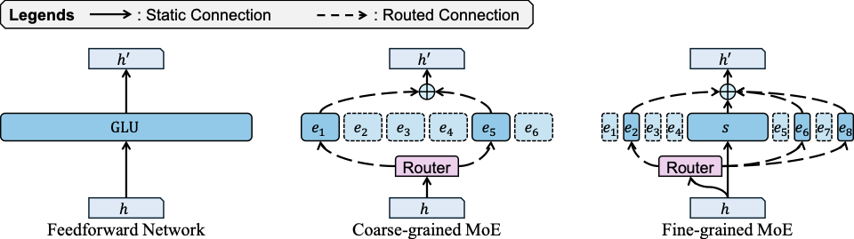
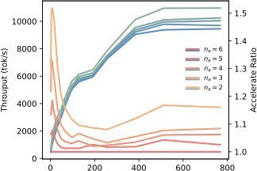

## Abstract

In fine-grained sparse Mixture-of-Experts (MoE) models, a large pool of specialized experts replaces a small homogeneous set, shifting performance and throughput to be governed by inference-time expert activation. Yet most existing optimization recipes implicitly assume a fixed activation budget (e.g., a constant Top-k per layer), whose behavior in fine-grained MoEs is poorly understood. We first characterize runtime skipping strategies, quantifying the accuracy–efficiency trade-off of (i) uniform fixed activation and (ii) static layer-wise Top-k allocation found by search. Our analysis reveals that static skipping can already provide substantial throughput gains, but optimal static schedules vary significantly across models and routing mechanisms. We therefore introduce Adaptive Skipping with Entropy-Penalized Thresholding (ASET), a training-free policy that adapts token-level activation using router confidence and entropy while remaining within the model’s original budget. Across the fine-grained MoEs we study, static skipping policies yield 10–78% throughput gains with minimal performance degradation, including ≥10% improvement on DeepSeek-V3 without measurable loss. On the OLMoE testbed, ASET yields a Pareto frontier between average activation and task quality. Overall, these results identify expert skipping as a practical lever for faster fine-grained MoE inference, with adaptive activation helping when fixed budgets are too rigid.
