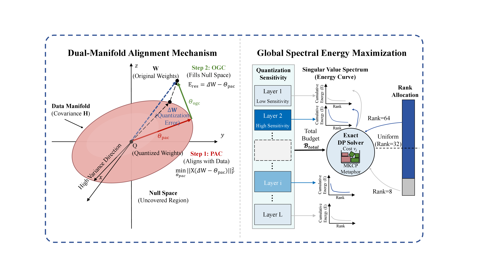
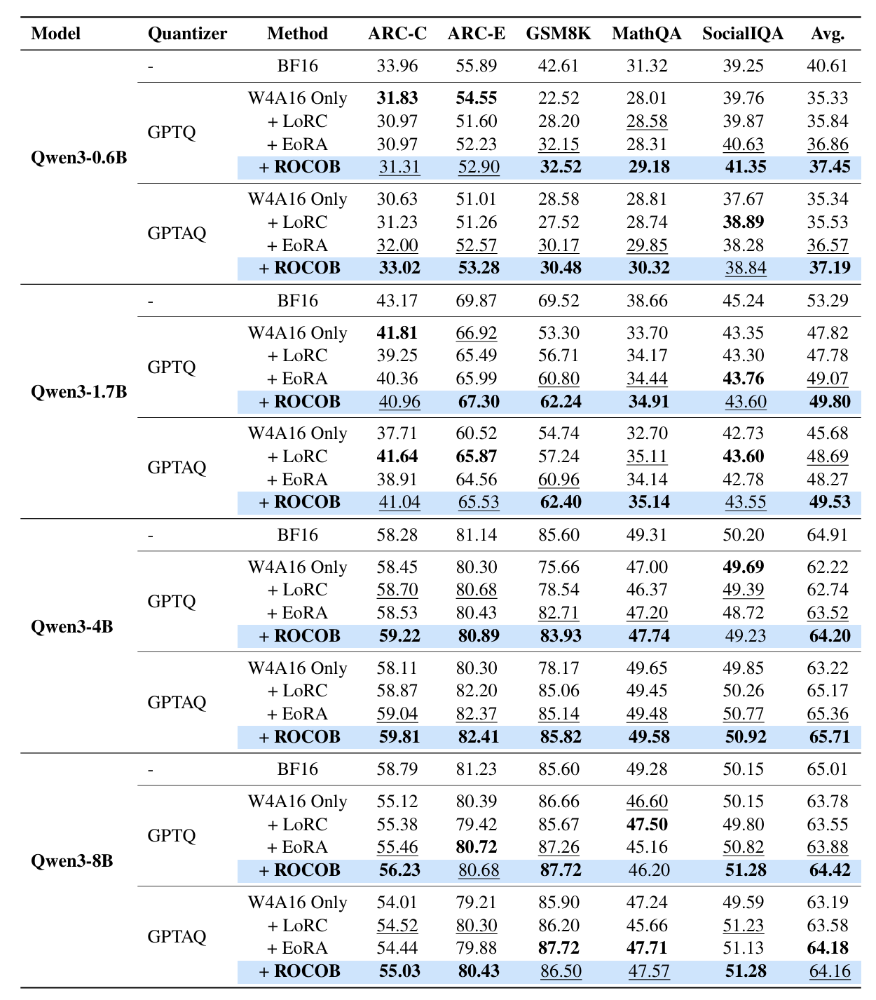

## Abstract

Post-training quantization facilitates efficient LLM deployment, yet it disproportionately erodes reasoning and mathematical performance. To recover fidelity without costly fine-tuning, we identify a critical vulnerability in existing output-space methods: the tendency to overfit the limited calibration manifold, which necessitates structural regularization for unseen data. We propose **ROCOB** (**R**esilient **O**utput **C**ompensation with **O**ptimal **B**udgeting), a training-free framework based on *Dual-Manifold Alignment*. ROCOB couples a Principal Activation Component (PAC), which minimizes error on the calibration manifold, with an Orthogonal Geometric Component (OGC), which recovers residual weight-space structure without fitting a second calibration objective. To compare methods fairly under the same added-parameter budget, ROCOB uses Global Spectral Energy Maximization (GSEM) to allocate ranks according to recovered spectral energy and module cost. Across Qwen3 and Llama-3 models, quantizers, and reasoning benchmarks, ROCOB improves average post-quantization recovery in most evaluated model–quantizer settings while preserving a training-free construction pipeline.

